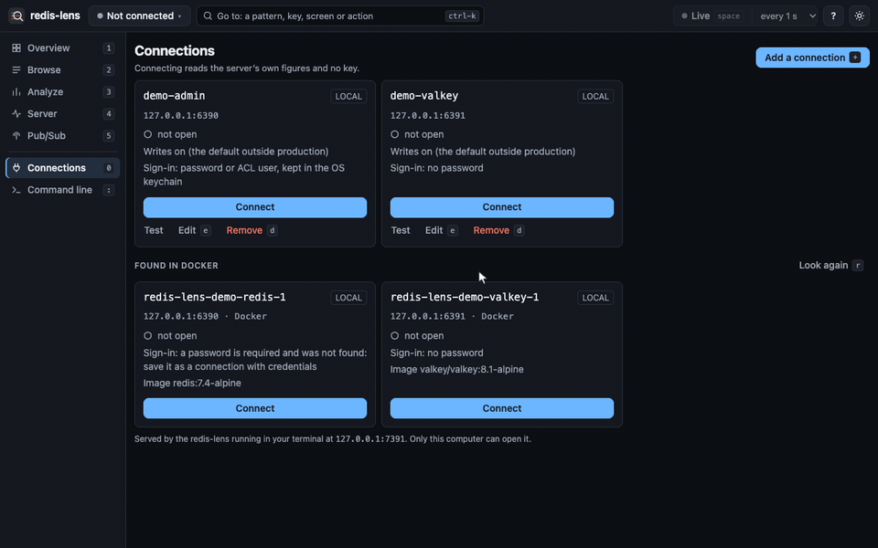

<div align="center">
  
  <h1>redis-lens</h1>
  <p><strong>A terminal UI and a web dashboard for Redis and Valkey.</strong></p>
  <p>
    <a href="https://github.com/magna-nz/redis-lens/actions/workflows/ci.yml"></a>
    <a href="https://crates.io/crates/redis-lens"></a>
    <a href="https://www.rust-lang.org/"></a>
    <a href="https://valkey.io/"></a>
    <a href="#license"></a>
  </p>
  <p><a href="https://magna-nz.github.io/redis-lens/"><strong>Documentation</strong></a></p>
</div>

redis-lens lists your keys and shows their values, finds the keys and key patterns that use the most memory, and shows live server stats, connected clients, the slow log and Pub/Sub messages.
You can also run commands and edit keys from it.

It runs in the terminal, and the same program serves a web dashboard on 127.0.0.1 that only you can open.
The dashboard has every screen the terminal has: connections, browsing and editing keys and values, bulk actions, Streams, Search, the analysis, the server, Pub/Sub and the command line.

Connections marked as production are read-only unless you turn writes on.

<div align="center">
  
  <p><em>In the terminal</em></p>
  
  <p><em>In the browser</em></p>
</div>

## What you can do

- **Find any key:** `ctrl-f` from any screen searches the whole server by name or pattern.
- **Browse keys and values:** every Redis type, plus JSON, streams and module types, decoded as JSON, MessagePack, hex and more.
- **See what uses memory:** keys grouped into patterns like `user:{id}:cart`, with big keys, hot keys and keys that never expire.
- **Watch the server:** live stats, clients, the slow log, `MONITOR` and Pub/Sub.
- **Run commands:** a command line with completion and help, and replies as text, a table or JSON.
- **Edit data:** add, edit, expire and delete keys. Production profiles are read-only unless you allow writes.
- **Connect to anything:** ACL users, TLS, cluster, Sentinel, SSH tunnels, cloud IAM sign-in and Docker discovery.
  Passwords stay in the OS keychain.
- **Check it in CI:** save snapshots, compare them over time, and fail a build on rules you set.
- **Use it in a browser:** a web dashboard on your own computer with every screen the terminal has: connections, keys and values (with edits and bulk actions), Streams, Search, the analysis, the server, Pub/Sub and the command line.
  It follows the same rules as the terminal: read-only production, writes asked about, passwords only in the keychain.

## Install

```sh
# Homebrew (macOS, Linux)
brew install magna-nz/tap/redis-lens
# Shell installer (macOS, Linux)
curl --proto '=https' --tlsv1.2 -LsSf https://github.com/magna-nz/redis-lens/releases/latest/download/redis-lens-installer.sh | sh
# PowerShell installer (Windows)
powershell -ExecutionPolicy Bypass -c "irm https://github.com/magna-nz/redis-lens/releases/latest/download/redis-lens-installer.ps1 | iex"
# crates.io (Rust 1.89+); add --features entra-id for Microsoft Entra ID sign-in
cargo install redis-lens --locked
```

Or download a binary for macOS, Linux or Windows from [GitHub Releases](https://github.com/magna-nz/redis-lens/releases).

## Get started

```sh
redis-lens conn add local --url redis://localhost:6379
redis-lens              # the terminal UI; press ? for every key, ctrl-o to open the dashboard
redis-lens --dashboard  # only the dashboard, opened in your browser
redis-lens --terminal   # only the terminal UI, no dashboard
```

From a clone, `make demo` starts a seeded Redis and Valkey in Docker to try it on.

## Contributing

```sh
make test   # unit tests
make it     # integration tests against Redis and Valkey (Docker)
make lint   # rustfmt and clippy
```

Behaviour is defined in [`spec.md`](spec.md); a change to behaviour updates it in the same pull request.
Releases: [`docs/releasing.md`](docs/releasing.md).

## License

[MIT](LICENSE)
