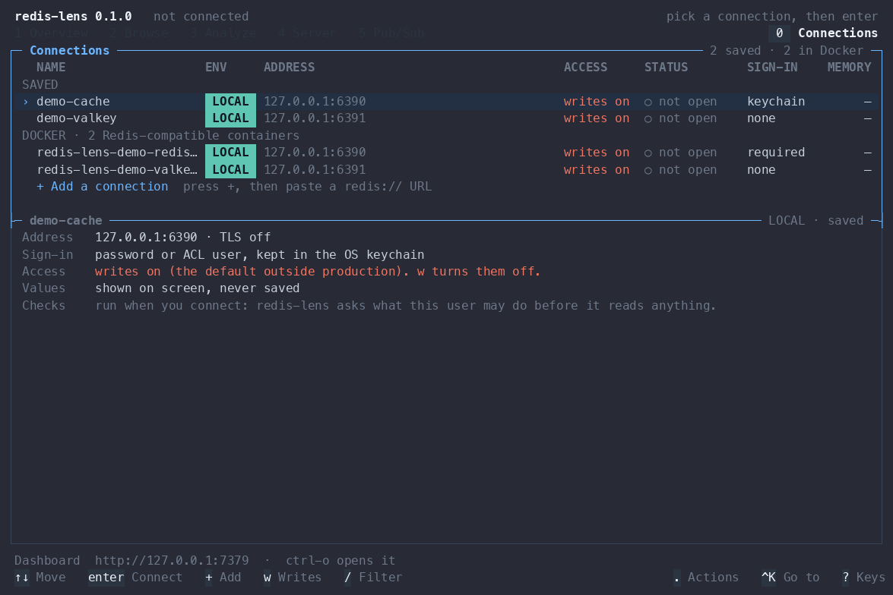

<div align="center">
  
  <h1>redis-lens</h1>
  <p><strong>Redis Insight in your terminal, for Redis and Valkey.</strong></p>
  <p>
    <a href="https://github.com/magna-nz/redis-lens/actions/workflows/ci.yml"></a>
    <a href="https://www.rust-lang.org/"></a>
    <a href="https://valkey.io/"></a>
    <a href="#license"></a>
  </p>
  <p><a href="https://magna-nz.github.io/redis-lens/"><strong>Documentation</strong></a></p>
</div>

Browse keys, watch the server, run commands, and find out what is using your memory, all from a terminal. It is
safe to point at production: read-only by default, and it never runs `KEYS`.

<div align="center">
  
</div>

## What you can do

- **Find any key:** `ctrl-f` from any screen searches the whole server by name or pattern.
- **Browse keys and values:** every Redis type, plus JSON, streams and module types, decoded as JSON, MessagePack, hex and more.
- **See what uses memory:** keys grouped into patterns like `user:{id}:cart`, with big keys, hot keys and keys that never expire.
- **Watch the server:** live stats, clients, the slow log, `MONITOR` and Pub/Sub.
- **Run commands:** a command line with completion and help, and replies as text, a table or JSON.
- **Edit data:** add, edit, expire and delete keys. Production profiles are read-only unless you allow writes.
- **Connect to anything:** ACL users, TLS, cluster, Sentinel, SSH tunnels, cloud IAM sign-in and Docker discovery.
  Passwords stay in the OS keychain.
- **Check it in CI:** save snapshots, compare them over time, and fail a build on rules you set.

## Install

```sh
cargo install --git https://github.com/magna-nz/redis-lens
```

## Get started

```sh
redis-lens conn add local --url redis://localhost:6379
redis-lens            # pick a connection; press ? for every key
```

From a clone, `make demo` starts a seeded Redis and Valkey in Docker to try it on.

## Contributing

```sh
make test   # unit tests
make it     # integration tests against Redis and Valkey (Docker)
make lint   # rustfmt and clippy
```

Behaviour is defined in [`spec.md`](spec.md); a change to behaviour updates it in the same pull request.

## License

[Apache-2.0](LICENSE-APACHE) or [MIT](LICENSE-MIT), at your option.
