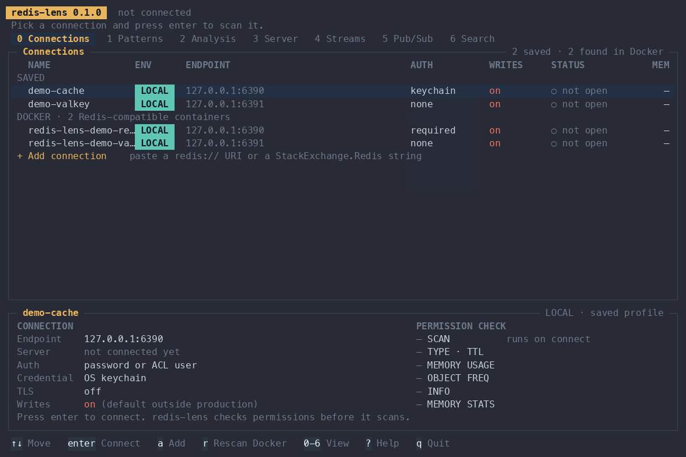

<div align="center">
  
  <h1>redis-lens</h1>
  <p><strong>A terminal UI that shows what is using memory in Redis and Valkey, and whether any of it is a mistake.</strong></p>
  <p>
    <a href="https://github.com/magna-nz/redis-lens/actions/workflows/ci.yml"></a>
    <a href="https://crates.io/crates/redis-lens"></a>
    <a href="https://www.rust-lang.org/"></a>
    <a href="https://valkey.io/"></a>
    <a href="#license"></a>
  </p>
  <p>
    <a href="#authentication"></a>
  </p>
</div>

<br>

You have a Redis or Valkey that is using more memory than you expected. `INFO memory` tells you how much. It does not
tell you which keys. redis-lens samples the keyspace, groups keys into patterns such as `user:{id}:cart`, and shows
what each pattern costs: keys, memory, average size and how many have no TTL.

It answers one question: what is using the memory, and is any of it a mistake? Carts that never expire, a cache
that only grows, an import job that never cleans up, one huge queue. Those show up as rows you can read.

It is built to be safe on production. It is read-only and never sends a write command. It walks the keyspace with
`SCAN` and never `KEYS`. It stays under a command budget. Credentials live in your OS keychain, not in a file.

<div align="center">
  
</div>

<br>

## Install

```sh
cargo install redis-lens
```

Or download a binary for Linux, macOS or Windows from [GitHub Releases](https://github.com/magna-nz/redis-lens/releases).
Building from source needs Rust 1.89 or newer.

## Try it in 30 seconds

You need Docker and a Rust toolchain.

```sh
make demo
```

This starts a Redis 7 on port 6390 (ACL users `lens` and `lens-limited`) and a Valkey 8 on port 6391 (no auth), and
seeds them with a keyspace that has planted problems: carts without TTLs, search results without TTLs, an orphaned
import job, a large queue and a few hot keys. It saves both as connections, puts the demo password in your keychain,
and opens the TUI. `make demo-down` stops it and deletes the data.

## Use

### Save a connection

```sh
# Prompts for the password without echoing it. The password goes to the keychain.
redis-lens conn add prod-cache --url rediss://lens-ro@prod-cache.internal:6380 --env prod --ask-password

# Or read it from standard input.
printf '%s' "$REDIS_PASSWORD" | redis-lens conn add staging --url redis://lens-ro@staging:6379 --env stage --password-stdin

redis-lens conn list
redis-lens conn test prod-cache      # connect and run the permission check
redis-lens conn remove prod-cache    # also deletes the keychain entry
```

`--url` takes `redis://[user[:password]@]host[:port][/db]`, `rediss://` for TLS, or a StackExchange.Redis string such
as `host:6380,password=...,ssl=True`. A password typed into the URL works, but it lands in your shell history, so
prefer `--ask-password` or `--password-stdin`. `--env` is `prod`, `stage`, `local` or `other`, and is guessed from
the host if you leave it out. `--force` replaces a profile with the same name.

`--config <path>` or `REDIS_LENS_CONFIG` points at a different config file.

### The TUI

```sh
redis-lens
```

| Key | Action |
|---|---|
| `0` to `4` | Switch view: Connections, Patterns, TTL, Diff, Hot keys |
| `↑` `↓` | Move |
| `→` `←` | Expand and collapse a pattern |
| `/` | Filter |
| `s` | Save a snapshot of the current scan |
| `a` | Add a connection (Connections view). The password is masked in the preview. |
| `enter` | Connect to the selected profile |
| `q` | Quit |

Narrow terminals scroll sideways instead of wrapping.

### Scan from the command line

```sh
redis-lens scan prod-cache
redis-lens scan prod-cache --sample 20000 --match 'user:*'
redis-lens scan prod-cache --json > report.json
redis-lens scan prod-cache --max-rate 1000 --save
```

| Flag | Meaning |
|---|---|
| `--sample N` | Stop after N keys. Default 100,000. |
| `--match GLOB` | Only scan keys matching the glob. |
| `--json` | Print the report as JSON instead of a table. |
| `--max-rate N` | At most N commands per second. `0` means no limit. |
| `--save` | Save the report as a snapshot. |

### Compare with an earlier scan

```sh
redis-lens diff prod-cache
redis-lens diff prod-cache --against ~/old-snapshot.json --json
```

`diff` scans, compares with the newest earlier snapshot for that profile (or the file given to `--against`), and then
saves the new scan. It takes `--max-rate` and `--json` too.

### Find containers

```sh
redis-lens discover
```

Lists running Docker containers that look like Redis or Valkey.

## The five views

**Connections.** Saved profiles and the Redis or Valkey containers found in Docker. Each row shows the name,
environment badge (PROD, STAGE, LOCAL, OTHER), endpoint, auth method, status and memory. The detail panel shows the
server version, topology, where the credentials come from, TLS, and the permission check results.

**Patterns.** Key patterns sorted by estimated memory, with type, estimated keys, share of memory, average size,
the percentage with no TTL, and the change since the last snapshot. Child patterns group under their prefix. The
detail panel shows example keys with sizes and TTLs, p50, p99 and max size, a TTL histogram, a one-line verdict and a
suggested command.

**TTL.** Patterns ranked by TTL risk. *Mixed* means most keys expire but some don't, which is probably a bug.
*Persistent and growing* is a likely leak. *Persistent and stable* is treated as intentional. Each row has a
histogram over none, under 1 minute, 1 hour, 1 day, 7 days, 30 days and over 30 days.

**Diff.** The current scan against a saved snapshot: before, after, change and percentage change for each pattern.
It says whether growth came from more keys or from bigger values, and flags new patterns.

**Hot keys.** Keys ranked by LFU counter (`OBJECT FREQ`), with pattern, type, size and node. Keys that are both hot
and big are flagged. This needs an LFU eviction policy such as `allkeys-lfu`. Without one the view says so.

Pattern inference splits keys on `:`, `/` and `|`, and replaces UUIDs, ULIDs, numeric ids, long hex hashes and IPv4
addresses with placeholders. For example `user:88213:cart` becomes `user:{id}:cart`.

## Authentication

| Method | How |
|---|---|
| None | No `AUTH` is sent. |
| ACL user and password, or password only | Both are stored in the OS keychain. |
| TLS | `rediss://` or `ssl=True`, verified against the webpki root certificates. |
| Microsoft Entra ID | Behind a cargo feature, see below. |
| Docker discovery | Containers are found through the Docker socket. |

**Entra ID.** For Azure Cache for Redis and Azure Managed Redis. Install with the feature enabled:

```sh
cargo install redis-lens --features entra-id
redis-lens conn add azure-cache --url rediss://my-cache.redis.azure.net:10000 --env prod --entra
```

It uses the developer-tools credential, so run `az login` first. Managed identity is not verified yet. Azure hosts
(`*.redis.cache.windows.net`, `*.redis.azure.net`) are recognised and the environment is guessed from the host name.

**Docker discovery.** Lists running containers whose image is redis, valkey, redis-stack or bitnami/redis and that
publish port 6379. A password found in `--requirepass` or in `REDIS_PASSWORD` or `VALKEY_PASSWORD` is held in memory
only.

**The keychain.** Usernames and passwords are stored in the macOS Keychain, Windows Credential Manager or the Secret
Service on Linux. There is one entry per profile: service `redis-lens`, account `profile:<name>`. The config file
holds the profile name, host, port, TLS setting and environment, and nothing secret. Credentials never appear in
logs, error text or snapshots.

On macOS, a keychain entry is tied to the binary that wrote it. After an upgrade or a rebuild, macOS asks once
whether redis-lens may use it. Choose **Always Allow**. Until you answer, connecting waits.

## Least-privilege ACL user

redis-lens needs only a handful of read commands. A minimal user:

```
ACL SETUSER lens-ro on >… ~* resetchannels -@all +ping +hello +client|setinfo +client|setname +select +info +dbsize +scan +type +ttl +pttl +memory|usage +object|freq
```

Before scanning, redis-lens tries each command once and turns off what it can't use. It never aborts a scan over a
missing permission.

| Missing | What you lose |
|---|---|
| `MEMORY USAGE` | Sizes. You still get key counts and TTLs. |
| `OBJECT FREQ`, or a non-LFU eviction policy | The Hot keys view. |
| A key ACL on some keys (`NOPERM`) | Those keys' sizes. The scan carries on. |

`conn test <name>` shows the result of the check.

## Safety

- Read-only. redis-lens never sends a write command. Profiles with env `prod` are read-only by default.
- The keyspace is walked with `SCAN cursor COUNT n`. Never `KEYS`. Per-key commands (`TYPE`, `PTTL`, `MEMORY USAGE
  ... SAMPLES 5`, `OBJECT FREQ`) are pipelined in batches.
- A command budget limits load. The default is no limit for `local` profiles and 5,000 commands per second for
  everything else. Change it with `--max-rate`.
- Scans stop at 100,000 keys by default. Counts are then scaled up to estimates using `DBSIZE`. If the whole
  keyspace was seen, or `--match` is used, no scaling is applied.

## Snapshots and diffs

`s` in the TUI, or `redis-lens scan --save`, writes the scan as JSON to
`<data dir>/redis-lens/snapshots/<profile>/<YYYYMMDDTHHMMSSZ>.json`. On macOS the data dir is
`~/Library/Application Support`. A snapshot holds patterns and example key names. It never holds values or
credentials. Example key names can still be sensitive, so treat snapshot files like the data they describe.

`redis-lens diff <profile>` and the Diff view compare a scan with the newest earlier snapshot.

A cron job that runs `redis-lens scan <profile> --save` once a day gives you something to diff against.

## Development

```sh
make test       # unit tests, no Docker
make it         # integration tests against Redis and Valkey in Docker
make lint       # rustfmt check and clippy with -D warnings
make demo-up    # start and seed the demo servers without opening the TUI
make demo-down  # stop the demo and delete its data
make gif        # record docs/demo.gif (needs agg and demo/gif-steps.json)
```

`demo/record.py` drives redis-lens in a pseudo-terminal from a JSON list of keystrokes and writes an asciinema cast.
`make gif` runs it and then `agg`. See `make help` for the full list.

`spec.md` describes the intended behaviour and `status.md` tracks progress.

## License

Licensed under either of [Apache License, Version 2.0](LICENSE-APACHE) or [MIT license](LICENSE-MIT) at your option.
